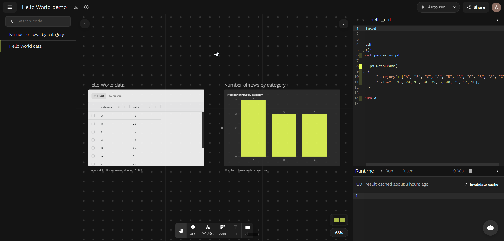
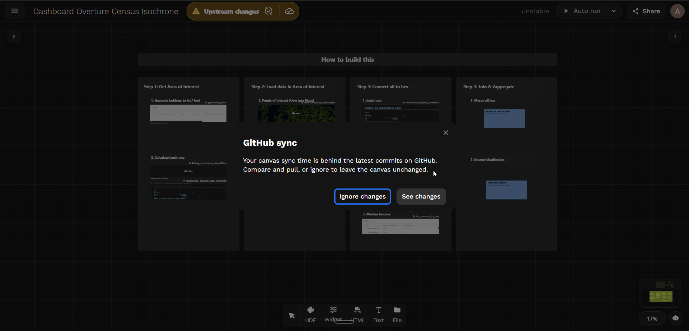
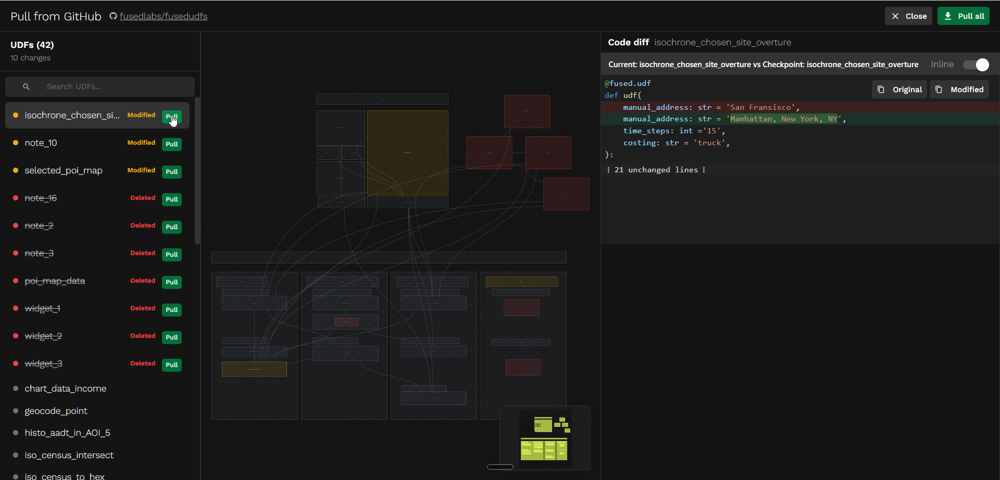

import Tabs from '@theme/Tabs';
import TabItem from '@theme/TabItem';

# Using AI

AI coding tools like Claude Code, GitHub Copilot and Codex can write UDFs, wire widgets and push canvases for you. Fused publishes its [skills plugin](https://github.com/fusedio/skills) so the tool already knows the `canvas.toml` format, how to structure a UDF, which props each widget takes and which `fused` CLI commands to run. You don't have to explain any of it in your prompts.

To build UDFs that agents call as tools, see [Building for Agents](/guide/working-with-udfs/udf-best-practices/agents).

## Install the Fused skills

The skills use the [`fused` CLI](/cli/overview) to push and run canvases. Install it with [uv](https://docs.astral.sh/uv/getting-started/installation/):

```bash
uv tool install fused
```

To install with pip instead, see [Install](/cli/overview#install). Then install the `workbench` plugin in your coding tool:

<Tabs>
  <TabItem value="claude" label="Claude Code">

[Install Claude Code](https://docs.anthropic.com/en/docs/claude-code/setup), then:

```bash
fused workbench claude plugin add
```

Or from Claude Code directly:

```bash
claude plugin marketplace add fusedio/skills
claude plugin install workbench@fused-marketplace
```

Update with `fused workbench claude plugin update` and remove with `fused workbench claude plugin remove`.

  </TabItem>
  <TabItem value="copilot" label="Copilot CLI">

[Install the Copilot CLI](https://docs.github.com/en/copilot/how-tos/copilot-cli/set-up-copilot-cli/install-copilot-cli), then:

```bash
fused workbench copilot plugin add
```

Or from the Copilot CLI directly:

```bash
copilot plugin marketplace add fusedio/skills
copilot plugin install workbench@fused-marketplace
```

Start a new `copilot` session to use the skills. Update with `fused workbench copilot plugin update` and remove with `fused workbench copilot plugin remove`. Any Copilot plan works, including Copilot Free.

  </TabItem>
  <TabItem value="vscode" label="VS Code">

Copilot Chat in VS Code loads skills from [agent plugins](https://code.visualstudio.com/docs/copilot/customization/agent-plugins), so turn on the `chat.plugins.enabled` setting first. If you installed the plugin with the Copilot CLI, VS Code already picks it up.

1. Run **Chat: Manage Plugin Marketplaces** from the Command Palette, select **Add Marketplace...** and enter `fusedio/skills`.
2. Open the Extensions view and search for `@agentPlugins`.
3. Find **workbench** from `fused-marketplace` and select **Install**.

To check the skills loaded, type `/` in the Chat input. To update, run **Extensions: Check for Extension Updates**. To remove, right-click **workbench** in the **Agent Plugins - Installed** view and select **Uninstall**.

  </TabItem>
  <TabItem value="codex" label="Codex">

[Install the Codex CLI](https://developers.openai.com/codex/cli), then:

```bash
fused workbench codex plugin add
```

Update with `fused workbench codex plugin update` and remove with `fused workbench codex plugin remove`.

  </TabItem>
</Tabs>

The first time the tool runs a Fused command, your browser opens so you can log in to Fused. Finish logging in within 30 seconds, or run [`fused workbench login`](/cli/login) yourself.

<details>
<summary>Install the skills without the plugin</summary>

If your organization turns off plugins, install the skills on their own. They're plain [Agent Skills](https://agentskills.io) folders. Clone them once:

```bash
git clone https://github.com/fusedio/skills ~/.fused-plugins
```

Then link them where your tool reads personal skills. The Copilot CLI and VS Code read `~/.agents/skills`, and Claude Code reads `~/.claude/skills`:

```bash
mkdir -p ~/.agents/skills ~/.claude/skills
ln -s ~/.fused-plugins/workbench/skills/* ~/.agents/skills/
ln -s ~/.fused-plugins/workbench/skills/* ~/.claude/skills/
```

To update them, run `git -C ~/.fused-plugins pull`.

</details>

## Try it out

Ask your coding tool to build a canvas from scratch:

```
Make a Hello World canvas with some dummy data and a chart showing the number of rows in the data
```

It writes the UDF, wires up a chart widget and pushes the canvas to your account with the `fused` CLI:



## Edit an existing canvas

Pull the canvas to a local folder. This downloads the UDF `.py` files, `canvas.toml` and widget JSON into a folder named after the canvas:

```bash
fused workbench canvas pull <canvas_name>
```

Ask your coding tool to change the files, then push that folder back:

```bash
fused workbench canvas push <canvas_folder>
```

The push replaces the remote canvas with your local folder, so any UDF missing locally is removed. Workbench then shows that the server has a newer version:



Click **Compare** to review the diff, then pull all UDFs at once or pick individual ones:



See [Versioning](/workbench/versions/) for checkpoints, diffs and restoring earlier states.

## Other ways to use AI

- **[Fused Render](/workbench/fused-render)**: a desktop app that opens your canvases next to a coding agent and pushes every save, so you skip the pull and push steps.
- **AI Chat in Workbench**: a built-in chat for quick questions and small edits in the browser.
