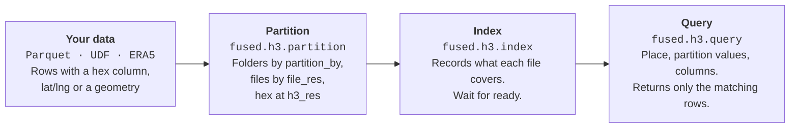

# Partition, Index and Query

[`fused.h3.partition`](/python-sdk/api-reference/h3#partition) writes your data as H3 Parquet files, [`fused.h3.index`](/python-sdk/api-reference/h3#index) registers them so they can be searched, and [`fused.h3.query`](/python-sdk/api-reference/h3#query) returns only the rows a request needs. This page gives the best practices for each step, then applies them to Overture buildings.



## Concepts

- **Hex column:** every row carries the H3 cell it falls in, in a column named `hex`. `h3_res` sets the cell size: higher means smaller. Queries select rows by this column. New to H3? See [Working with H3](/guide/working-with-udfs/udf-best-practices/working-with-h3).
- **Folders and files:** partition writes one folder per value of the `partition_by` column and, inside each folder, one file per larger parent cell, whose size `file_res` sets.
- **Index:** records the cells, partition values and time range each file covers, so a query skips every file it does not need.

What partition wrote for the [example below](#example-overture-buildings). Every row has `hex` at res 11 and the source columns.

```text
fd://overture_us_buildings/v5/h3/
├── _manifest.json                 h3_res, file_res, partition_by
├── building_type=commercial/      one folder per partition_by value
│   └── 852aa803fffffff.parquet    one file per res-5 parent cell (file_res)
├── building_type=religious/
│   └── 852aa803fffffff.parquet
└── ...                            10 building_type folders
```

## Source data

Partition reads a source, such as `fused.h3.sources.parquet` or `fused.h3.sources.udf`, or a path on `s3://`, `gs://` or `fd://`. It does not take a DataFrame: return one from a UDF instead.

| Your data has | Pass |
|---|---|
| An H3 cell column | `hex_column="hex"`. The cells are kept as they are and `h3_res` is not applied. If the files already have an integer `hex` at one resolution, skip partition and [index](#index) them directly. |
| Latitude and longitude | `point_column=("lat", "lng")` |
| A geometry column (WKB) | `point_column="geometry"`. Each row gets the cell of its centroid. To use another point, compute `hex` yourself and pass `hex_column`. |

Pass exactly one of `hex_column` and `point_column`. Data that has both a `hex` column and a geometry column needs only `hex_column`, and the geometry stays in the files either way. Coordinates must be longitude and latitude in degrees (EPSG:4326). Choose `h3_res` from the size of your features with the [Resolution Guide](/guide/h3-analytics/resolution-guide).

## Partition

[`fused.h3.partition`](/python-sdk/api-reference/h3#partition) writes the data as H3 Parquet. It runs as a background job and returns a run at once.

- **Partition by the column your queries filter on.** If queries rarely filter by a category, leave `partition_by` unset.
- **Partition values** must not be null or empty, contain `/` or start with `_`: they become folder names.
- **Avoid skewed columns.** If one value holds most rows, a query for it still reads almost every file.
- **Set `h3_res` and `file_res` yourself.** The defaults, 7 and 1, suit few datasets.
- **Choose the engine by data size:**

| `engine` | Machine | Time limit | Use for |
|---|---|---|---|
| `"realtime"` | – | a few minutes | small Parquet sources; a UDF source raises |
| `"small"` (default) | 2 vCPUs, 2 GB | none | most datasets |
| `"medium"` | 16 vCPUs, 64 GB | none | large inputs |
| `"large"` | 64 vCPUs, 512 GB | none | very large inputs |

:::warning
`overwrite=True` on partition replaces everything in the output folder. Leave it off unless you mean to rebuild, and write to your own folder. In a UDF that starts jobs, default to reporting status, for example with a `run=False` parameter.
:::

## Index

[`fused.h3.index`](/python-sdk/api-reference/h3#index) registers the files with the query service. Re-runs are incremental; `overwrite=True` indexes everything again.

- **Index after every partition or append,** and wait until `status` is `ready`. A query against a file that changed after it was indexed fails.
- **After an append, index only the new folders** with `prefix=`, such as `prefix="building_type=civic"`, instead of walking the whole tree.
- **Use a batch engine for large datasets.** The default, `"realtime"`, is limited to a few minutes.

## Query

[`fused.h3.query`](/python-sdk/api-reference/h3#query) returns the matching rows as a DataFrame.

- **Always give a place:** `bbox=`, `cell=`, or `lat=` and `lng=`. Without one, it returns the whole dataset.
- **Filter by partition values:** one value or a list, such as `partition={"building_type": ["religious", "commercial"]}`. Only place, time and partition values are filtered; filter other columns on the returned DataFrame.
- **Request only the columns you use** with `columns=`, and split very large areas into smaller queries.

To query over HTTP, use [`GET /h3/query`](/rest-api/h3).

## Example: Overture buildings

Overture building footprints in central Annapolis, Maryland, become an H3 dataset that a map queries by its bounding box and by building type.

| Item | Value |
|---|---|
| Source | [Overture](https://overturemaps.org/) buildings, release `2026-04-15-0`, Fused's copy on Source Cooperative |
| Area | 10 km × 10 km around Annapolis: `(-76.5628, 38.9501, -76.4472, 39.0399)` (west, south, east, north) |
| Saved source | `fd://overture_us_buildings/v5/source/buildings.parquet` |
| Output | `fd://overture_us_buildings/v5/h3/` |
| Settings | `h3_res=11`, `file_res=5`, `partition_by="building_type"` |

### 1. Source: `read_buildings_res5`

A UDF returns one row per building whose centre is inside the box, with its footprint polygon. It downloads only the Overture chunks that overlap the box and drops buildings without a type, because Overture's `subtype` becomes the partition column `building_type`. Running the UDF once with `save=True` writes the GeoDataFrame to `fd://overture_us_buildings/v5/source/buildings.parquet`, and every later step reads that file instead of Overture.

### 2. Partition: `partition_buildings`

Partition reads the saved file on a batch job, with `engine` left at `"small"`. The rows have a geometry and no `hex`, so it passes `point_column="geometry"`. Res 11, about 25 m across, fits buildings; res 5 groups the files.

```python
fused.h3.partition(
    fused.h3.sources.parquet("fd://overture_us_buildings/v5/source/buildings.parquet"),
    "fd://overture_us_buildings/v5/h3/",
    point_column="geometry",
    h3_res=11,
    file_res=5,
    partition_by="building_type",
    overwrite=True,
)
```

The UDF only starts the job with `run=True`. With `run=False`, the default, it shows the rows per `building_type` value, which is where to check for skew.

### 3. Index: `index_buildings`

With `run=True`, the UDF indexes again, waits up to 110 seconds and shows the status.

```python
path = "fd://overture_us_buildings/v5/h3/"
fused.h3.index(path, overwrite=True).tail(timeout=110)
status = fused.h3.index_status(path)
```

**Returns:** `status` is a dict with `status` `'ready'`, `indexing` `False`, `files` 10, `resolution` 11, and `partition_columns` `building_type` (10 values).

### 4. Query: `query_buildings`

The UDF returns the buildings inside the map's bounding box for the types in `building_type`, `religious,commercial` by default (empty means all), with only the six columns the map shows.

```python
df = fused.h3.query(
    "fd://overture_us_buildings/v5/h3/",
    bbox=(-76.5628, 38.9501, -76.4472, 39.0399),
    partition={"building_type": ["religious", "commercial"]},
    columns=["id", "building_type", "class", "floors", "height", "geometry"],
)
```

**Returns:** 98 rows, 80 `commercial` and 18 `religious`.

To use another area, change the bounding box in step 1 and run it with `save=True`, run partition with `run=True`, then index with `run=True`, and pan the map there.

## Canvas

[Open the H3_End_to_End_Ingestion canvas →](https://www.fused.io/canvas/fc_fused/H3_End_to_End_Ingestion)


## Reference

- [H3 Data Retrieval Service](/guide/h3-analytics/data-retrieval-service): the workflow at a glance
- [Large dataset examples](/guide/h3-analytics/hex-datasets)
- [`fused.h3`](/python-sdk/api-reference/h3): the Python API
- [`GET /h3/query`](/rest-api/h3): every parameter
- [Resolution Guide](/guide/h3-analytics/resolution-guide)
- [Raster ingestion pipeline](/guide/h3-analytics/raster-ingestion)
