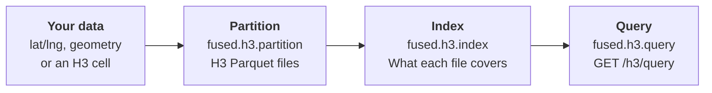

# Partition, Index and Query

Fused's [H3 Data Retrieval Service](/guide/h3-analytics/data-retrieval-service) turns your data into an H3 dataset that returns the rows you ask for in seconds. It takes three steps: partition, index and query. This page gives the best practices for each step, then a worked example on Overture buildings.



## Concepts

- **[Partition](/python-sdk/api-reference/h3#partition)** writes your data as H3 Parquet files, grouped into folders and files so a query can skip most of them.
- **[Index](/python-sdk/api-reference/h3#index)** records the cells, partition values and time range each file covers. Query needs it.
- **Query** uses the index to read only the files a request needs, from a UDF running on Fused with [`fused.h3.query`](/python-sdk/api-reference/h3#query) or over HTTP with [`GET /h3/query`](/rest-api/h3).
- **Resolution:** H3 cells come in 16 sizes, and a higher resolution means smaller cells. Choose one from the size of your features with the [Resolution Guide](/guide/h3-analytics/resolution-guide). New to H3? See [Working with H3](/guide/working-with-udfs/udf-best-practices/working-with-h3).

## Prepare your data

Every row needs a location. [`fused.h3.partition`](/python-sdk/api-reference/h3#partition) reads it from one of two parameters, `point_column` or `hex_column`, set to the names of your columns:

- **Latitude and longitude:** `point_column=("lat", "lng")`.
- **A geometry, such as polygons:** `point_column="geometry"`, a WKB column. Each row gets the cell of its centroid.
- **An H3 cell:** `hex_column="hex"`. The cells are kept as they are.

Pass only one. If you have both a cell column and a geometry, use `hex_column`. Coordinates must be longitude and latitude in degrees (EPSG:4326). Partition reads Parquet from a path or [`fused.h3.sources.parquet`](/python-sdk/api-reference/h3#sourcesparquet), or a UDF's output with [`fused.h3.sources.udf`](/python-sdk/api-reference/h3#sourcesudf), not a DataFrame.

## Partition

[`fused.h3.partition`](/python-sdk/api-reference/h3#partition) runs as background jobs and returns a run at once. [`fused.h3.get_run(run_id)`](/python-sdk/api-reference/h3#get_run) gives its status, [`.tail()`](/python-sdk/api-reference/h3#tail) its logs, and [`.retry()`](/python-sdk/api-reference/h3#retry) runs the failed jobs again.

- **`h3_res` and `file_res`:** `h3_res` sets each row's cell, and `file_res` the larger cell each file covers. Set both: the defaults, 7 and 1, suit few datasets. A higher `file_res` makes more, smaller files, so a query reads less.
- **`partition_by`:** one folder per value of the column your queries filter on. Values cannot be null or empty, contain a `/`, or start with `_`. Avoid a column where one value holds most rows. A column name takes the values from the data in one job. A dict such as `{"date": ["2024-07-04", "2024-07-05"]}` runs one job per combination of values, each bound to the source's input of that name: a UDF parameter, or a hive folder for `sources.parquet`.
- **`engine`:** `"small"` (the default), `"medium"` and `"large"` run as [batch jobs](/guide/working-with-udfs/udf-best-practices/scaling-out#instance-types) with no time limit. `"realtime"` stops after 2 minutes, so it suits only small Parquet sources; a UDF source raises with it.
- **Running again:** with column names, every run reads the source again and replaces the folders it writes; all other folders stay. With a dict, jobs already done are skipped and `redo=True` runs them again. Without `partition_by`, a run into an existing output raises. To change `h3_res`, `file_res`, `fill`, `sort_by` or the partition columns, write to a new output path.

:::warning
In a UDF that starts a job, guard the call so it runs only when you ask: otherwise every re-run of the UDF starts the job again.
:::

## Index

[`fused.h3.index`](/python-sdk/api-reference/h3#index) registers the files with the query service. It returns a run at once; `.tail()` prints its logs until it finishes. Re-runs are incremental; `redo=True` indexes everything again.

- **Re-run index after every partition,** and wait until `fused.h3.index_status` reports `ready`. A partition run that rewrites files makes the index stale even when the data is the same, and queries fail with an "index is stale" error until you index again.
- **New data: run index again.** It indexes only new, changed and removed files and skips unchanged folders. On a large dataset, also pass the new folders as `subset=`, such as `subset={"<partition column>": "<value>"}`, so index lists only those folders instead of the whole dataset. The keys must be the leading partition columns.
- **Use a [batch engine](/guide/working-with-udfs/udf-best-practices/scaling-out#dedicated-instances) for large datasets:** `"small"`, `"medium"` or `"large"`. The default, `"realtime"`, stops after 2 minutes.

## Query

[`fused.h3.query`](/python-sdk/api-reference/h3#query) returns the matching rows as a DataFrame. It runs only inside a UDF on Fused; anywhere else it raises a `RuntimeError`.

- **Always give a place:** `bbox=`, `cell=`, or `lat=` and `lng=`. Without one, it returns the whole dataset.
- **Filter by partition values:** one value or a list, such as `partition={"<partition column>": ["<value>", "<value>"]}`. Only place, time and partition values are filtered; filter other columns on the returned DataFrame.
- **Request only the columns you use** with `columns=`.
- **Split a large result** into smaller areas or time windows. The whole result is held in the UDF's memory, so one too large fails the job.

To query from outside a UDF, use [`GET /h3/query`](/rest-api/h3). It takes the same place and partition filters as query parameters, with an [access token](/rest-api/overview#authentication), and returns a Parquet file:

```bash
curl -G "https://www.fused.io/server/v1/h3/query" \
  -H "Authorization: Bearer $FUSED_ACCESS_TOKEN" \
  --data-urlencode "path=fd://overture_us_buildings/v1/h3/" \
  -d min_lng=-76.62 -d min_lat=39.285 -d max_lng=-76.6 -d max_lat=39.3 \
  --data-urlencode 'partition={"building_type": ["residential", "commercial"]}' \
  -o buildings.parquet
```

## Example: Overture buildings


The **Polygons: Overture buildings → H3** group in the [H3_End_to_End_Ingestion canvas](https://www.fused.io/canvas/fc_fused/H3_End_to_End_Ingestion) holds this example. In it, we download 955,857 Overture building footprints around Baltimore, Maryland, once, partition them into H3 files by building type, index them, then query them from a map: once through a UDF and once straight from [`GET /h3/query`](/rest-api/h3). The [UDFs](/python-sdk/api-reference/fused-udf) that start partition and index jobs are guarded by a `run` parameter, so they only start a job when it is turned on.

- **Source:** [Overture](https://overturemaps.org/) buildings, release `2026-04-15-0`, [Fused's copy on Source Cooperative](https://source.coop/fused/overture)
- **Area:** 60 km × 60 km around Baltimore, `(-76.96, 39.02, -76.26, 39.56)` (west, south, east, north), passed as [`bounds`](/guide/working-with-udfs/udf-best-practices/geospatial-single-vs-tile#bounds)
- **Settings:** `h3_res=11`, `file_res=4`, `partition_by="building_type"`; see [`fused.h3.partition`](/python-sdk/api-reference/h3#partition)

### 1. Download: `download_buildings`

Overture has no query API, so the UDF reads each part's `_metadata`, downloads only the chunks that overlap the box, and keeps the buildings whose centre is inside it. Most Overture buildings have no type, and partition values cannot be null, so a missing type becomes `building_type="unknown"`. The buildings are saved to [Fused storage](/python-sdk/api-reference/api#upload) as GeoParquet, one file per res-3 cell, together with the box and release they came from: running the UDF again with the same values skips the download.

**Returns:** 3 files with 862,670, 65,109 and 28,078 buildings, in about 30 seconds.

### 2. Partition: `partition_buildings`

The rows have a geometry and no cell column, so partition reads them with [`fused.h3.sources.parquet`](/python-sdk/api-reference/h3#sourcesparquet) and gives each building the cell of its centroid at res 11, about 25 m across (see the [Resolution Guide](/guide/h3-analytics/resolution-guide)). Res 4 groups the files.

```python
job = fused.h3.partition(
    fused.h3.sources.parquet("fd://overture_us_buildings/v1/raw/"),
    "fd://overture_us_buildings/v1/h3/",
    point_column="geometry",
    h3_res=11,
    file_res=4,
    partition_by="building_type",
    engine="realtime",
)
```

The source is small, so the job runs on `"realtime"` with no machine to start. [`fused.h3.get_run(job.id)`](/python-sdk/api-reference/h3#get_run) gives its status, and [`.tail()`](/python-sdk/api-reference/h3#tail) its logs. A second run reads the source again and replaces only the `building_type` folders it writes.

**Writes:** one folder per `building_type` and one file per res-4 cell. Every row has `hex` at res 11 and the source columns.

```text
h3/
├── _manifest.json                 h3_res, file_res, partition_by, rows per folder
├── building_type=residential/
│   ├── 842aa81ffffffff.parquet    one file per res-4 cell
│   └── ...
├── building_type=unknown/
│   └── ...
└── ...                            14 building_type folders, 85 files
```

### 3. Index: `index_buildings`

The UDF runs [`fused.h3.index`](/python-sdk/api-reference/h3#index) with `redo=True`, so every run indexes all files again. It follows the run to the end, then shows [`fused.h3.index_status`](/python-sdk/api-reference/h3#index_status).

```python
path = "fd://overture_us_buildings/v1/h3/"
fused.h3.index(path, redo=True).tail()
status = fused.h3.index_status(path)
```

**Returns:** indexing takes about 4 seconds. Then `status` is a dict with `status` `'ready'`, `files` 85, `resolution` 11 and `partition_columns` `building_type` (14 values).

### 4. Query: `query_buildings`

The UDF calls [`fused.h3.query`](/python-sdk/api-reference/h3#query) and returns the buildings inside [`bounds`](/python-sdk/api-reference/fused-types#bounds) for the types in `building_type` (comma-separated; empty means all), as a DataFrame with the geometry as WKB. It refuses boxes wider than 0.05 degrees, so a map never asks for all 1M buildings.

```python
@fused.udf
def udf():
    return fused.h3.query(
        "fd://overture_us_buildings/v1/h3/",
        bbox=(-76.62, 39.285, -76.6, 39.3),
        partition={"building_type": ["residential", "commercial"]},
        columns=["building_type", "class", "height", "geometry"],
    )
```

**Returns:** 301 rows, 163 `commercial` and 138 `residential`. With every type, the same box returns 2,470 rows in about 1 second.

Two maps show the result:

- **4a. Map from the UDF:** a [`fused-map`](/guide/data-input-outputs/import-connection/fused-map) layer runs `query_buildings` once per [map tile](/guide/working-with-udfs/udf-best-practices/geospatial-single-vs-tile#tile-udf) from zoom 15, so panning queries the new area, and colours footprints by `building_type`.
- **4b. Map from `/h3/query`:** a [`fused-hex` layer](/guide/h3-analytics/visualization#from-an-indexed-dataset) calls [`GET /h3/query`](/rest-api/h3) per tile with no UDF, from zoom 13, and colours each res-11 cell by its number of buildings. It cannot filter by `building_type`.

```json
{
  "type": "fused-hex",
  "h3Column": "hex",
  "minZoom": 13,
  "source": {"path": "fd://overture_us_buildings/v1/h3/", "variables": ["height"], "reduce": "sum"}
}
```

To use another area, change `bounds` in step 1, partition into a new output path, index that path, and point the query UDF and the `fused-hex` layer at it. A re-run into the same path would keep any `building_type` folder the new area does not write.

## Reference

- [H3 Data Retrieval Service](/guide/h3-analytics/data-retrieval-service): the workflow at a glance
- [Large dataset examples](/guide/h3-analytics/hex-datasets)
- [`fused.h3`](/python-sdk/api-reference/h3): the Python API
- [`GET /h3/query`](/rest-api/h3): every parameter
- [Resolution Guide](/guide/h3-analytics/resolution-guide)
- [Raster ingestion pipeline](/guide/h3-analytics/raster-ingestion)
- [H3_End_to_End_Ingestion canvas](https://www.fused.io/canvas/fc_fused/H3_End_to_End_Ingestion)
