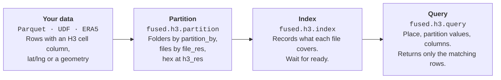

# Partition, Index and Query

[`fused.h3.partition`](/python-sdk/api-reference/h3#partition) writes your data as H3 Parquet files, [`fused.h3.index`](/python-sdk/api-reference/h3#index) registers them so they can be searched, and [`fused.h3.query`](/python-sdk/api-reference/h3#query) or the [`GET /h3/query`](/rest-api/h3) endpoint returns only the rows a request needs. This page gives the best practices for each step, then a worked example on Overture buildings.



## Concepts

- **Hex column:** every row needs the H3 cell it falls in. Partition computes it from latitude and longitude or a geometry, or uses a cell column you already have, whatever its name. `h3_res` sets the cell size: higher means smaller. New to H3? See [Working with H3](/guide/working-with-udfs/udf-best-practices/working-with-h3).
- **Folders and files:** partition writes one folder per value of the `partition_by` column and, inside each folder, one file per larger parent cell, whose size `file_res` sets.
- **Index:** records the cells, partition values and time range each file covers, so a query skips every file it does not need.

## Source data

Partition reads a source, such as `fused.h3.sources.parquet` or `fused.h3.sources.udf`, or a path on `s3://`, `gs://` or `fd://`. It does not take a DataFrame: return one from a UDF instead. Tell it where each row is with one of:

- **Latitude and longitude:** `point_column=("lat", "lng")`.
- **A geometry, such as polygons:** `point_column="geometry"`, a WKB column. Each row gets the cell of its centroid.
- **A cell column already:** `hex_column="<name>"`. The cells are kept as they are and `h3_res` does not change them.

Pass only one. Data with both a cell column and a geometry needs only `hex_column`; the geometry stays in the files. Coordinates must be longitude and latitude in degrees (EPSG:4326). Choose `h3_res` from the size of your features with the [Resolution Guide](/guide/h3-analytics/resolution-guide).

## Partition

[`fused.h3.partition`](/python-sdk/api-reference/h3#partition) writes the data as H3 Parquet. It runs as a background job on the machine set by `engine` and returns a run at once. Follow its logs with `run.tail()`, or later with `fused.h3.get_run(run.id).tail()`.

- **Partition by the column your queries filter on.** If queries rarely filter by a category, leave `partition_by` unset.
- **Partition values** must not be null or empty, contain `/` or start with `_`: they become folder names.
- **Avoid skewed columns.** If one value holds most rows, a query for it still reads almost every file.
- **Set `h3_res` and `file_res` yourself.** The defaults, 7 and 1, suit few datasets. Pick `h3_res` from the size of your features, and raise `file_res` for more, smaller files so a query reads less. The example below uses 11 and 4.
- **Choose the engine by data size:** `"small"` (the default), `"medium"` or `"large"` run as [batch jobs](/guide/working-with-udfs/udf-best-practices/batch-jobs#dedicated-instances) with no time limit; see [instance types](/guide/working-with-udfs/udf-best-practices/batch-jobs#instance-types) for their sizes. `"realtime"` needs no machine to start but stops after 2 minutes, so it suits only small Parquet sources.

:::warning
`overwrite=True` on partition replaces everything in the output folder. Leave it off unless you mean to rebuild, and write to your own folder. In a UDF that starts jobs, default to reporting status, for example with a `run=False` parameter.
:::

## Index

[`fused.h3.index`](/python-sdk/api-reference/h3#index) registers the files with the query service. Re-runs are incremental; `overwrite=True` indexes everything again.

- **Re-run index after every partition or append,** and wait until `status` is `ready`. Otherwise queries fail with an "index is stale" error.
- **New data: run index again without `overwrite`.** It indexes only new, changed and removed files and skips the rest. On a large dataset, also pass the new folders as `prefix=`, such as `prefix="building_type=civic"`, so index lists only those folders instead of the whole dataset.
- **Use a [batch engine](/guide/working-with-udfs/udf-best-practices/batch-jobs#dedicated-instances) for large datasets:** `"small"`, `"medium"` or `"large"`. The default, `"realtime"`, stops after 2 minutes.

## Query

[`fused.h3.query`](/python-sdk/api-reference/h3#query) returns the matching rows as a DataFrame.

- **Always give a place:** `bbox=`, `cell=`, or `lat=` and `lng=`. Without one, it returns the whole dataset.
- **Filter by partition values:** one value or a list, such as `partition={"building_type": ["religious", "commercial"]}`. Only place, time and partition values are filtered; filter other columns on the returned DataFrame.
- **Request only the columns you use** with `columns=`.
- **Split a result too large for one read,** which fails with HTTP 413, into smaller areas or time windows.

To query over HTTP, use [`GET /h3/query`](/rest-api/h3). It takes the same place and partition filters as query parameters, with an [access token](/rest-api/overview#authentication), and returns a Parquet file:

```bash
curl -G "https://www.fused.io/server/v1/h3/query" \
  -H "Authorization: Bearer $FUSED_ACCESS_TOKEN" \
  --data-urlencode "path=fd://overture_us_buildings/v1/h3/" \
  -d min_lng=-76.62 -d min_lat=39.285 -d max_lng=-76.6 -d max_lat=39.3 \
  --data-urlencode 'partition={"building_type": ["residential", "commercial"]}' \
  -o buildings.parquet
```

## Example: Overture buildings

In this example, we download 955,857 Overture building footprints in a 60 km × 60 km box around Baltimore, Maryland, once, partition them into H3 files by building type, index them, then query them from a map: once through a UDF and once straight from `/h3/query`.

| Item | Value |
|---|---|
| Source | [Overture](https://overturemaps.org/) buildings, release `2026-04-15-0`, Fused's copy on Source Cooperative |
| Area | 60 km × 60 km around Baltimore: `(-76.96, 39.02, -76.26, 39.56)` (west, south, east, north) |
| Raw data | `fd://overture_us_buildings/v1/raw/`, 3 GeoParquet files |
| Output | `fd://overture_us_buildings/v1/h3/`, 85 files |
| Settings | `h3_res=11`, `file_res=4`, `partition_by="building_type"` |

### 1. Download: `download_buildings`

Overture has no query API, so the UDF reads each part's `_metadata`, downloads only the chunks that overlap the box, and keeps the buildings whose centre is inside it. Most Overture buildings have no type, and partition values cannot be null, so a missing type becomes `building_type="unknown"`. The buildings are saved as GeoParquet in `v1/raw/`, one file per res-3 cell, together with the box and release they came from: running the UDF again with the same values skips the download.

**Returns:** 3 files with 862,670, 65,109 and 28,078 buildings, in about 30 seconds.

### 2. Partition: `partition_buildings`

The rows have a geometry and no cell column, so partition gives each building the cell of its centroid at res 11, about 25 m across. Res 4 groups the files.

```python
job = fused.h3.partition(
    fused.h3.sources.parquet("fd://overture_us_buildings/v1/raw/"),
    "fd://overture_us_buildings/v1/h3/",
    point_column="geometry",
    h3_res=11,
    file_res=4,
    partition_by="building_type",
)
```

With `run=True`, the UDF starts this job on a `"small"` batch machine and returns `job.id`. `overwrite` stays `False`, so a second run cannot replace the output by accident. With `run=False`, the default, it shows the rows per `building_type` from `_manifest.json`:

| `building_type` | Rows | Share |
|---|---|---|
| `unknown` | 605,157 | 63% |
| `residential` | 322,662 | 34% |
| `commercial` | 12,197 | 1% |
| 11 other types | 15,841 | 2% |

`unknown` holds most rows, so a query for it still reads most of the files: the skew to look for before you choose `partition_by`.

**Writes:** one folder per `building_type` and one file per res-4 cell. Every row has `hex` at res 11 and the source columns.

```text
fd://overture_us_buildings/v1/h3/
├── _manifest.json                 h3_res, file_res, partition_by, rows per folder
├── building_type=residential/
│   ├── 842aa81ffffffff.parquet    one file per res-4 cell
│   └── ...
├── building_type=unknown/
│   └── ...
└── ...                            14 building_type folders, 85 files
```

### 2b. Logs: `partition_logs`

The job takes about 20 seconds. Paste its `run_id` into `partition_logs`, which calls `fused.h3.get_run(run_id).tail()` and shows the job's status and log lines. Run it again for new lines.

### 3. Index: `index_buildings`

With `run=True`, the UDF indexes `v1/h3/` again and shows the status. Re-runs only index what changed.

```python
path = "fd://overture_us_buildings/v1/h3/"
fused.h3.index(path).tail(timeout=90)
status = fused.h3.index_status(path)
```

**Returns:** `status` is a dict with `status` `'ready'`, `files` 85, `resolution` 11 and `partition_columns` `building_type` (14 values), in about 4 seconds.

### 4. Query: `query_buildings`

The UDF returns the buildings inside `bounds` for the types in `building_type` (comma-separated; empty means all), as a DataFrame with the geometry as WKB. It refuses boxes wider than 0.05 degrees, so a map never asks for all 1M buildings.

```python
df = fused.h3.query(
    "fd://overture_us_buildings/v1/h3/",
    bbox=(-76.62, 39.285, -76.6, 39.3),
    partition={"building_type": ["residential", "commercial"]},
    columns=["building_type", "class", "height", "geometry"],
)
```

**Returns:** 301 rows, 163 `commercial` and 138 `residential`. With every type, the same box returns 2,470 rows in about 1 second.

Two maps show the result:

- **4a. Map from the UDF:** a `fused-map` layer runs `query_buildings` once per map tile from zoom 15, so panning queries the new area, and colours footprints by `building_type`.
- **4b. Map from `/h3/query`:** a `fused-hex` layer calls [`GET /h3/query`](/rest-api/h3) per tile with no UDF, from zoom 13, and colours each res-11 cell by its number of buildings. It cannot filter by `building_type`.

```json
{
  "type": "fused-hex",
  "h3Column": "hex",
  "minZoom": 13,
  "source": {"path": "fd://overture_us_buildings/v1/h3/", "variables": ["height"], "reduce": "sum"}
}
```

To use another area, change `bounds` in step 1, run partition with `run=True, overwrite=True`, then index with `run=True`.

## Canvas

[Open the H3_End_to_End_Ingestion canvas →](https://www.fused.io/canvas/fc_fused/H3_End_to_End_Ingestion)


## Reference

- [H3 Data Retrieval Service](/guide/h3-analytics/data-retrieval-service): the workflow at a glance
- [Large dataset examples](/guide/h3-analytics/hex-datasets)
- [`fused.h3`](/python-sdk/api-reference/h3): the Python API
- [`GET /h3/query`](/rest-api/h3): every parameter
- [Resolution Guide](/guide/h3-analytics/resolution-guide)
- [Raster ingestion pipeline](/guide/h3-analytics/raster-ingestion)
